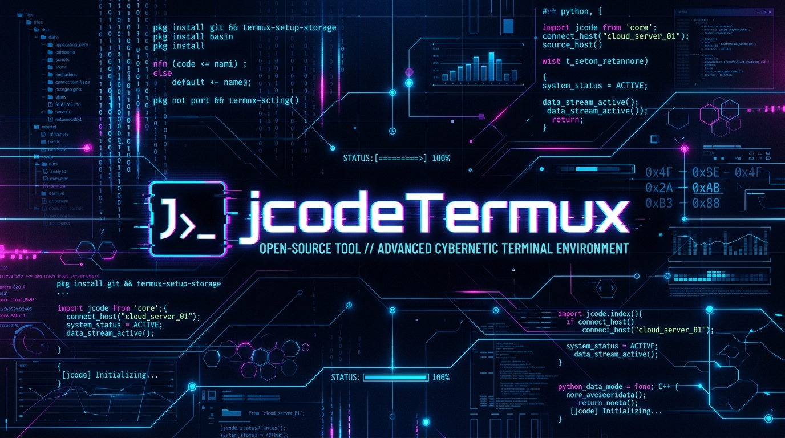

# jcodeTermux 📱⚡

<p align="center">
  
</p>

[](https://termux.dev)
[](#)

Optimización, instalación y entorno automatizado para ejecutar **JCode** (Framework de desarrollo y agente de IA en Rust) y **Walkie-Termux** (Orquestación de Agentes de IA P2P descentralizados) dentro de **Android** vía **Termux** de forma estable y optimizada.

---

## ⚠️ Requisito Crítico: Descarga de Termux

> [!IMPORTANT]
> **¡NO USES la versión de Google Play Store!** La versión de Termux en Google Play está descontinuada y desactualizada, lo que causará fallos graves en los repositorios de paquetes e incompatibilidades con el entorno `glibc`.

Para que `jcodeTermux` funcione correctamente, debes descargar Termux únicamente de sus fuentes oficiales activas:

*   📥 **[Descargar Termux desde GitHub Releases](https://github.com/termux/termux-app/releases)** (Recomendado)
*   📥 **[Descargar Termux desde F-Droid](https://f-droid.org/packages/com.termux/)**

---

## 🌟 JCode & Walkie-Termux en un solo lugar

Este repositorio unifica la configuración de dos herramientas fundamentales de IA y automatización para terminal móvil:

1.  **JCode:** Framework de desarrollo en Rust ultrarrápido con soporte multi-proveedor.
2.  **Walkie-Termux:** Orquestador de agentes y comunicación chat P2P descentralizada.

---

## 🛰️ Walkie-Termux (Orquestación P2P)

**Walkie-Termux** permite levantar canales P2P descentralizados y sin servidores centrales directamente en dispositivos móviles. Puedes usarlo para chat colaborativo o delegar tareas a agentes de IA.

### Comandos de Ejecución de Walkie:
*   **Chat de Terminal P2P:**
    ```bash
    walkie chat nombre-de-mi-canal
    ```
*   **Escucha del Agente de IA:**
    ```bash
    walkie agent nombre-de-mi-canal --cli codex --name "Asistente" --prompt "Eres un asistente servicial de Termux."
    ```
*   **Panel de Control Web UI:**
    ```bash
    walkie web
    ```
    *Accede vía `http://127.0.0.1:3000/?v=4` en tu navegador móvil.*

---

## 🛠️ Notas de Orquestación (Cómo se resolvió)

Durante el despliegue en Termux, se abordaron varios desafíos específicos de la plataforma:

1. **Corrección de Shebang en Android Node:**
   Las rutas estándar de shebang fallan en Termux debido a la estructura de directorios de Android. Corregimos el ejecutable global utilizando la herramienta de Termux:
   ```bash
   termux-fix-shebang $(which walkie)
   ```
2. **UI Web Responsiva para Móviles:**
   Ajustamos el diseño de la interfaz (`src/web-ui.js`) para soportar pantallas verticales y pantallas táctiles, implementando barras laterales colapsables automáticamente y un botón de retroceso móvil (`←`).
3. **Conexiones WebSocket en Chrome para Android:**
   Los navegadores móviles aplican estrictos límites de seguridad en las conexiones de loopback. Verificamos que al usar direcciones IP numéricas explícitas (`127.0.0.1:3000` o la IP local de la red) se evitan con éxito estas restricciones.
4. **Puente de Compatibilidad Glibc (Bypass para JCode y otras IA):**
   Al invocar IAs basadas en glibc (como `jcode`) desde Node.js en Termux, el proceso falla debido a conflictos de enlace de librerías (ya que Node.js hereda el entorno dinámico basado en Bionic de Termux). Lo solucionamos implementando un puente de entorno limpio en el spawn de `walkie`, eliminando las variables de Termux (`LD_PRELOAD`, `LD_LIBRARY_PATH`) e inyectando `GLIBC_TUNABLES="glibc.rtld.dynamic_sort=1"` para garantizar la ejecución.

---

## 📊 Comparativa de Eficiencia (jcode.sh)

A continuación se presenta un resumen de las métricas oficiales de rendimiento de JCode en comparación con otras herramientas CLI de agentes de IA y copitotos de código:

### 1. Consumo de Memoria por Sesión Adicional (PSS)
*Mide la cantidad de memoria RAM adicional requerida por cada sesión nueva.*

| Herramienta | Consumo de RAM (Extra PSS) | Comparativa |
| :--- | :--- | :--- |
| **jcode (local embedding off)** | **~9.9 MB** | **Línea Base (Mínimo)** |
| **jcode (completo)** | **~10.4 MB** | 1.1× más RAM |
| Codex CLI | ~21.6 MB | 2.2× más RAM |
| pi | ~76.5 MB | 7.7× más RAM |
| Antigravity CLI | ~86.4 MB | 8.7× más RAM |
| Cursor Agent | ~157.5 MB | 15.9× más RAM |
| GitHub Copilot CLI | ~158.1 MB | 16.0× más RAM |
| Claude Code | ~212.7 MB | 21.5× más RAM |
| OpenCode | ~318.4 MB | 32.2× más RAM |

### 2. Tiempo de Espera para el Primer Input
*Tiempo que transcurre desde el comando de inicio hasta que el usuario puede escribir en pantalla.*

| Herramienta | Tiempo de Respuesta | Retraso Comparado |
| :--- | :--- | :--- |
| **jcode** | **48.7 ms** | **Instantáneo (Línea Base)** |
| Antigravity CLI | 383.7 ms | 7.9× más lento |
| pi | 596.4 ms | 12.2× más lento |
| Codex CLI | 905.8 ms | 18.6× más lento |
| OpenCode | 1047.9 ms | 21.5× más lento |
| GitHub Copilot CLI | 1583.4 ms | 32.5× más lento |
| Cursor Agent | 1978.7 ms | 40.6× más lento |
| Claude Code | 3512.8 ms | 72.2× más lento |

### 3. Tiempo para el Renderizado del Primer Frame
*Tiempo necesario para que la interfaz TUI realice el primer dibujado completo en pantalla.*

| Herramienta | Tiempo de Renderizado | Retraso Comparado |
| :--- | :--- | :--- |
| **jcode** | **14.0 ms** | **Línea Base** |
| Antigravity CLI | 383.5 ms | 27.4× más lento |
| pi | 590.7 ms | 42.2× más lento |
| Codex CLI | 882.8 ms | 63.1× más lento |
| OpenCode | 1035.9 ms | 74.0× más lento |
| GitHub Copilot CLI | 1518.6 ms | 108.5× más lento |
| Cursor Agent | 1949.7 ms | 139.3× más lento |
| Claude Code | 3436.9 ms | 245.5× más lento |

---

## 📖 ¿Por qué es necesario jcodeTermux?

El binario oficial de **JCode** está compilado nativamente para arquitecturas GNU/Linux estándar enlazadas contra **glibc**. Al intentar ejecutarlo en Android/Termux, ocurren los siguientes problemas:
1. **Incompatibilidad de libc:** Android utiliza **Bionic libc**, lo que causa fallos de enlazado dinámico.
2. **Shebangs Corruptos:** El instalador genera wrappers apuntando a `#!/usr/bin/env bash`, ruta que no existe de forma nativa en Termux.
3. **TUI Glitch (Inestabilidad Visual):** Los terminales emulados en móviles colapsan ante actualizaciones continuas de alta frecuencia (como las animaciones de carga e idle a 25+ FPS), ocultando el texto del chat.

**jcodeTermux** soluciona esto aplicando reglas y optimizaciones de compatibilidad de binarios y buffers dinámicos para Android.

---

## 🛠️ El Configurador Interactivo (`setup.sh`)

El repositorio incluye un script con interfaz de menú interactivo en el terminal:

```text
======================================================================
         __                 __  ______                                
        / /____  ____  ____/ / /_  __/___  ________ ___  __  ___  __  
   __  / / ___/ / __ \/ __  /   / / / _  \/ ___/ __ \`__ \/ / / / |/_/  
  / /_/ / /__  / /_/ / /_/ /   / / /  __/ /   / / / / / / /_/ />  <    
  \____/\___/  \____/\__,_/   /_/  \___/_/   /_/ /_/ /_/\__,_/_/|_|    
                                                                      
     Tactical JCode & Walkie Installer & Configurator for Termux        
======================================================================
 Soporte: JCode & Walkie-Termux | Sponsor: Ivam3 | Estado: Termux-Optimized
----------------------------------------------------------------------

 1) Instalar / Reinstalar JCode (Termux Patch)
 2) Optimizar Pantalla y Animaciones de JCode
 3) Administrar Servidor Daemon JCode
 4) Instalar / Reinstalar Walkie-Termux (P2P Client)
 5) Ejecutar Walkie-Termux (Chat, Agente o Web UI)
 6) Diagnóstico de Sistema y Autenticación
 7) Desinstalar Todo (JCode & Walkie)
 8) Salir

 Elige una opción [1-8]: 
```

---

## 🚀 Instalación Rápida

Ejecuta la siguiente secuencia de comandos en tu terminal de Termux:

```bash
# Clonar el repositorio
git clone https://github.com/kuromi04/jcodeTermux.git

# Entrar al directorio
cd jcodeTermux

# Hacer ejecutable e iniciar el configurador
chmod +x setup.sh
./setup.sh
```

---

## ⚙️ Optimización Visual Aplicada a JCode

El asistente modifica automáticamente tu archivo `~/.jcode/config.toml` con parámetros ajustados para Termux:

*   **`idle_animation = false`**: Detiene las animaciones continuas en reposo, garantizando que el texto del chat permanezca visible.
*   **`prompt_entry_animation = false`**: Evita la corrupción y el desfase del cursor al escribir prompts.
*   **`disabled_animations = []`**: Mantiene activa la animación de presentación inicial (splash screen) en el arranque.
*   **`animation_fps = 10` y `redraw_fps = 12`**: Modera el tráfico de redibujados, logrando fluidez gráfica y protegiendo la batería del móvil.
*   **`mouse_capture = false`**: Permite realizar scroll y copia de texto nativa táctil de Android sin bloqueos.

---

## 📚 Documentación Técnica & Skills

Para profundizar en la ingeniería y políticas de adaptación de binarios, consulta nuestra [Guía de Adaptación](docs/skills.md), que detalla:
*   Mapeo de intérpretes dinámicos de ELF con `patchelf`.
*   Ajustes y resolución de variables críticas (`GLIBC_TUNABLES`, `LD_PRELOAD`).
*   Troubleshooting y solución de errores en Termux.

---

## 💖 Créditos y Agradecimientos

Este proyecto y sus configuraciones han sido desarrollados por:

*   **[kuromi04](https://github.com/kuromi04) (Autor):** Creador del repositorio y desarrollador de los scripts de adaptación, automatizaciones de configuración visual y el menú táctico de instalación/desinstalación para Termux.
*   **[Ivam3](https://github.com/ivam3):** Creador y mantenedor de repositorios de paquetes de compatibilidad y optimizados que suministran glibc base para Termux, facilitando el soporte técnico.
*   **Comunidad de Termux:** Por el constante desarrollo y soporte para correr Linux en Android de forma nativa.

---

## 📄 Licencia

Este proyecto está bajo la Licencia MIT. Consulta el archivo `LICENSE` para más detalles.
