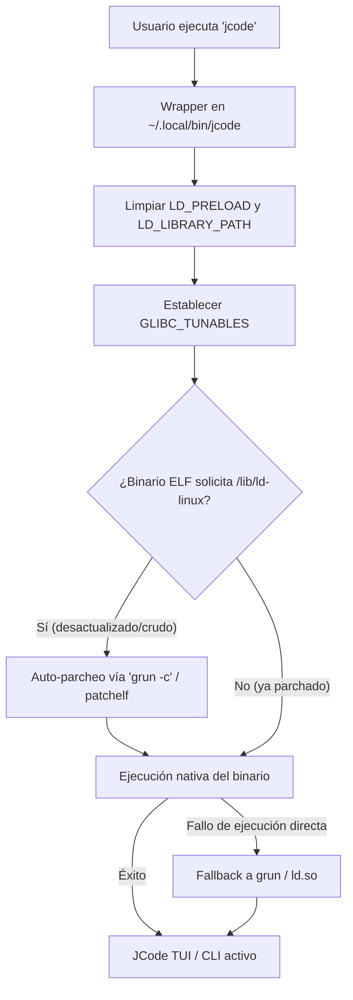

# Guía Experta de Adaptación y Skills: JCode en Termux

Esta guía documenta los conocimientos técnicos y habilidades necesarias para adaptar y solucionar problemas de **JCode** (y otros binarios nativos de alto rendimiento) dentro del entorno de Android usando **Termux**, enfocada en optimizar el rendimiento y compatibilidad del sistema.

---

## 🧭 1. Eje Principal de Conocimiento en Termux

El entorno de Termux en Android requiere ciertos estándares para la adaptación de herramientas sin necesidad de privilegios root.

### Pilares aplicados a JCode:
*   **Detección de Entorno:** Antes de interactuar con el binario, el sistema valida las características del entorno (arquitectura de CPU, cargadores disponibles).
*   **Aislamiento Bionic vs GLIBC:** Android utiliza **Bionic libc**, mientras que la mayoría de los agentes y compilados se desarrollan para GNU **glibc**. Se deben establecer estándares para enlazar dinámicamente librerías sin alterar el sistema base de Android.
*   **Fixer de Entorno:** Reglas para auditar directorios corruptos, sockets colgados y shebangs inválidos.

---

## ⚙️ 2. El Patrón del Wrapper GLIBC

Para que `jcode` pueda cargarse y ejecutarse dinámicamente con soporte glibc sin crasear debido a fallos de enlazado, se aplica el patrón del **wrapper de ejecución**.

### El cargador y las variables de entorno:
Se deben limpiar las variables nativas que puedan corromper la carga de librerías cruzadas (como `LD_PRELOAD`, usada comúnmente en Termux para termux-exec) y establecer los parámetros de sorting de glibc para compatibilidad aarch64.

### Adaptación del Binario ELF:
El binario original solicita `/lib/ld-linux-aarch64.so.1` como intérprete dinámico, ruta que no existe en Android. Para que el kernel de Android pueda ejecutarlo directamente, se parcha con `patchelf` o `grun -c`:
```bash
grun -c ~/.jcode/builds/stable/jcode
# o manualmente con patchelf:
patchelf --set-rpath "$PREFIX/glibc/lib" \
         --set-interpreter "$PREFIX/glibc/lib/ld-linux-aarch64.so.1" \
         "$(readlink -f ~/.jcode/builds/stable/jcode)"
```

### Flujo de Ejecución y Auto-Reparación:



### Estructura de Wrapper Estandarizada (Auto-reparación):
```bash
#!/data/data/com.termux/files/usr/bin/bash
# 1. Aislar de inyecciones nativas de Termux
unset LD_PRELOAD
unset LD_LIBRARY_PATH

# 2. Prevenir errores de orden dinámico en cargadores glibc
export GLIBC_TUNABLES="glibc.rtld.dynamic_sort=1"

TARGET="$HOME/.jcode/builds/stable/jcode"
REAL_BIN="$(readlink -f "$TARGET" 2>/dev/null || echo "$TARGET")"

# 3. Auto-reparación si el binario fue actualizado y aún no ha sido parchado
if [ -f "$REAL_BIN" ] && readelf -l "$REAL_BIN" 2>/dev/null | grep -q '/lib/ld-linux'; then
    command -v grun >/dev/null 2>&1 && grun -c "$REAL_BIN" >/dev/null 2>&1
fi

# 4. Lanzar el binario (directo o con fallback seguro a grun)
if [ -x "$TARGET" ]; then
    exec "$TARGET" "$@"
else
    exec grun "$TARGET" "$@"
fi
```

---

## 📺 3. Optimización de Renderizado en Terminales Móviles

Un pilar de experiencia de usuario en Termux es la optimización de los flujos TUI (Terminal User Interface). La potencia de un smartphone no se aprovecha correctamente si el emulador de terminal (Termux) colapsa dibujando la pantalla.

*   **Paso a un lado en escritura:** Evitar que los timers del agente refresquen bloques enteros de texto cuando el usuario ingresa datos.
*   **Desactivación de Animaciones en Reposo (`idle_animation = false`):** Previene ciclos infinitos de redibujado de pantalla que agotan el procesador móvil.
*   **Sincronización de Tasa de Refresco:** Reducir a `10 FPS` para animaciones y `12 FPS` para el redibujado general. Esto evita la caída o superposición de caracteres de texto (glitches de interpolación) y optimiza el consumo energético de la batería.
*   **Mouse Capture Desactivado (`mouse_capture = false`):** Permite el scrolling nativo de Android en el terminal, facilitando la copia y selección rápida de código generado.

---

## 🔍 4. Diagnóstico y Troubleshooting (Guía Rápida de Fixer)

Si `jcode` o `walkie` no responden o arrojan fallos, realiza las siguientes verificaciones:

1.  **Fallo de Intérprete (`bad interpreter`):**
    *   *Verificación:* Revisa el shebang del wrapper/ejecutable.
    *   *Causa:* Apunta a `/usr/bin/env` (inexistente).
    *   *Solución:* Cambiar a `#!/data/data/com.termux/files/usr/bin/bash` o ejecutar `termux-fix-shebang`.
2.  **Socket Bloqueado o Caídas Inexplicables:**
    *   *Causa:* Sockets Unix huérfanos tras cerrar la terminal abruptamente.
    *   *Solución:* Ejecutar `jcode server stop --force` para limpiar el socket activo.
3.  **Librería no encontrada (`shared library not found`):**
    *   *Causa:* El binario no fue correctamente parchado con el cargador glibc.
    *   *Solución:* Comprobar que `/data/data/com.termux/files/usr/glibc/lib/ld-linux-aarch64.so.1` existe.
